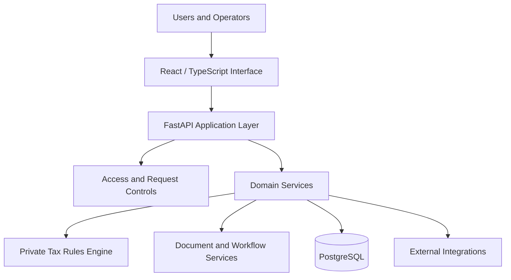

# Tax Automation Platform — Engineering Showcase

> A portfolio-facing overview of a modular platform concept for tax operations, fiscal analysis, workflow automation, and document management.

This repository presents the **architecture, engineering approach, and product scope** of a tax automation system without publishing its proprietary implementation, tax rules, client information, credentials, or private integrations.

## Project at a glance

The platform is designed to bring tax-related workflows into a unified environment, combining structured data, business rules, document workflows, and operational visibility.

| Area | Showcase |
|---|---|
| Product focus | Tax operations and fiscal workflow automation |
| Backend | Python, FastAPI |
| Frontend | React, TypeScript, Vite |
| Data layer | PostgreSQL |
| Core engineering themes | API design, modular services, workflow orchestration, data validation, automated testing |
| Repository purpose | Public technical case study; not the production source code |

## Why this project exists

Tax operations often involve fragmented information, repetitive document handling, manual checks, and workflows spread across different tools. The system's goal is to provide a more consistent operational layer for organizing these activities and supporting repeatable processes.

## Conceptual architecture

The diagram is intentionally high-level. It communicates system boundaries and responsibilities without exposing internal implementation details.

## Engineering approach

- **API-first backend:** HTTP endpoints provide a clear boundary between the user interface and application services.
- **Typed frontend:** React and TypeScript support maintainable UI components and explicit data contracts.
- **Relational persistence:** PostgreSQL provides structured storage for operational entities and workflow data.
- **Domain separation:** application workflows, persistence, and tax-specific logic are treated as distinct responsibilities.
- **Validation and testing:** automated checks are used to reduce regressions and improve confidence in changes.
- **Security by separation:** sensitive rules, credentials, customer data, and private integrations are intentionally excluded from this public repository.

## Technology stack

- Python
- FastAPI
- PostgreSQL
- React
- TypeScript
- Vite

## Repository contents

This is a documentation-only showcase. It does **not** contain the production application, proprietary source code, tax calculation rules, customer records, credentials, or private integration details.

## Project status and limitations

This repository is a technical presentation of the project, not a deployable product or a claim of regulatory approval. A feature being described here does not imply that it has been independently audited, certified, homologated by a government authority, or validated for every tax jurisdiction or business scenario.

Tax rules and obligations change and must be reviewed by qualified professionals before operational use. This showcase is not tax, legal, or accounting advice.

## Intellectual property

The implementation and domain-specific components are maintained separately. No license is granted to reuse proprietary implementation, business rules, or materials that are not explicitly published here.

## About the engineering

This project demonstrates work across backend architecture, API development, database-backed applications, frontend integration, workflow automation, and the design of systems that incorporate domain-specific rules.

For questions about the public technical overview, please use the repository's GitHub discussions or contact the repository owner through their GitHub profile.
