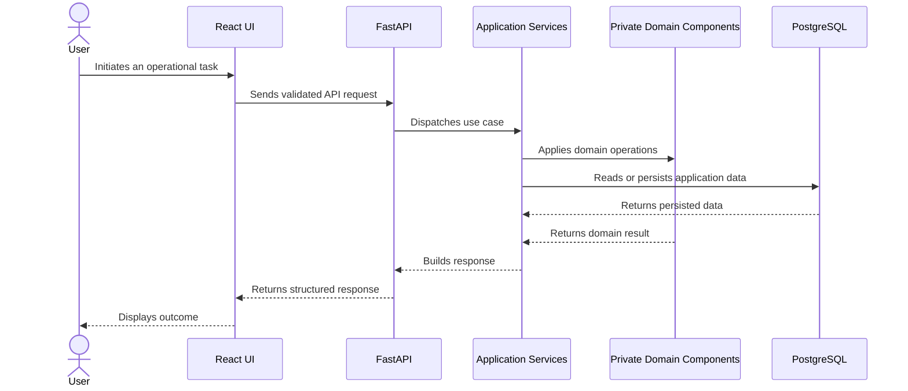

# Architecture Overview

This document describes the platform at the level appropriate for a public engineering portfolio. It intentionally omits private implementation details.

## Logical layers

1. **Presentation layer** — a React and TypeScript interface for operational users.
2. **API layer** — FastAPI endpoints that expose application capabilities through explicit request and response contracts.
3. **Application services** — orchestration of use cases, validation, and coordination between domain capabilities.
4. **Domain components** — tax-specific rules and workflows, maintained outside this public showcase.
5. **Persistence and integrations** — PostgreSQL for structured application data and controlled boundaries for external systems.

## Request lifecycle

## Design considerations

- Keep transport concerns separate from domain logic.
- Validate input at system boundaries.
- Make persistence and integration responsibilities explicit.
- Keep sensitive tax rules and customer-specific configuration out of public artifacts.
- Use automated tests to support safe iteration.

The diagrams are conceptual and do not disclose internal routes, schemas, formulas, or integration endpoints.
